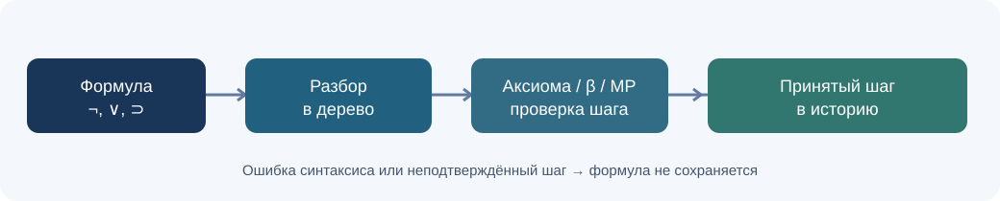
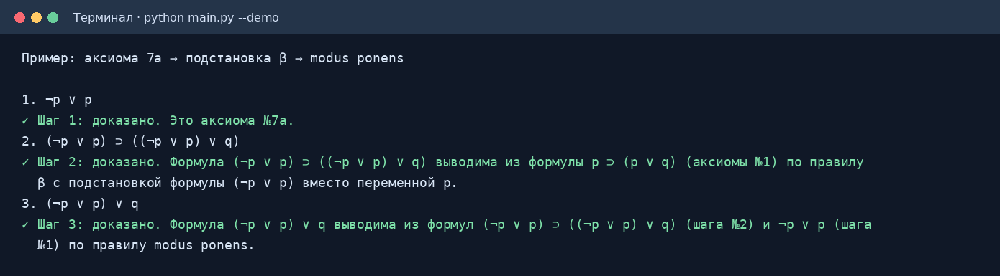

# Верификатор доказательств · ЛР №1, вариант 3

Программа проверяет доказательство в исчислении высказываний **по одному шагу**. На вход подаются формулы, на выходе для каждого шага показывается причина принятия: аксиома, подстановка β или modus ponens (MP). Ошибочная или недоказанная формула в историю не попадает.



## Запуск

Нужен Python **3.10+**. Сторонние библиотеки не используются. Откройте терминал в папке проекта:

```bash
python main.py
```

На Windows, если команда `python` не найдена, используйте `py main.py`.

Готовый трёхшаговый пример:

```bash
python main.py --demo
```



Проверка поведения программы:

```bash
python -m unittest discover -s tests -v
```

После запуска вводите по одной формуле в строку. Команды `:axioms`, `:list`, `:tree ФОРМУЛА`, `:help`, `:quit` показывают аксиомы, принятые шаги, синтаксическое дерево, справку и выход.

## Что означает вариант 3

Базовые операции варианта — **отрицание `¬`** и **дизъюнкция `∨`**. В исходной таблице аксиомы записаны также с импликацией `⊃`. Поэтому в программе импликация — сокращение для `A ⊃ B ≡ ¬A ∨ B`, и при разборе превращается в то же дерево. Можно вводить `→` или `->` вместо `⊃`, `!` или `~` вместо `¬`, `|` вместо `∨`.

Седьмая строка задания: `¬p ∨ p = ¬p ⊃ p ⊃ p`. Знак `=` связывает **две приведённые записи** закона исключённого третьего; это не логическая операция языка. Программа принимает обе записи как формы аксиомы 7 (7а и 7б), а `=` внутри вводимой формулы отклоняет. Правая запись понимается как `¬p ⊃ (p ⊃ p)`, поскольку импликация связывается справа.

| № | Аксиома из задания |
|:--:|:--|
| 1 | `p ⊃ (p ∨ q)` |
| 2 | `(p ∨ p) ⊃ p` |
| 3 | `(p ∨ (q ∨ r)) ⊃ (q ∨ (p ∨ r))` |
| 4 | `(q ⊃ s) ⊃ ((p ∨ q) ⊃ (p ∨ s))` |
| 5 | `¬¬p ⊃ p` |
| 6 | `(¬q ⊃ ¬p) ⊃ (p ⊃ q)` |
| 7а | `¬p ∨ p` |
| 7б | `¬p ⊃ (p ⊃ p)` |

Операции имеют приоритет `¬`, затем `∨`, затем `⊃`. Цепочка импликаций разбирается справа: `p ⊃ q ⊃ r` означает `p ⊃ (q ⊃ r)`. Скобки разрешены и вокруг одной переменной, и вокруг целой формулы, включая лишние внешние скобки. Переменная — одна латинская строчная буква `a`–`z`.

## Пример доказательства

Выполните `python main.py --demo` либо введите эти формулы вручную:

```text
1. ¬p ∨ p
2. (¬p ∨ p) ⊃ ((¬p ∨ p) ∨ q)
3. (¬p ∨ p) ∨ q
```

1. Первая формула совпадает с аксиомой 7а.
2. В аксиоме 1 `p ⊃ (p ∨ q)` **одна переменная** `p` заменена на **одну формулу** `¬p ∨ p`; замена применяется ко всем вхождениям `p` одновременно.
3. Из формул `A` и `A ⊃ B`, полученных на шагах 1 и 2, по MP следует `B = (¬p ∨ p) ∨ q`.

Это проверка предъявленного доказательства. Программа **не ищет** доказательство для произвольной целевой формулы автоматически и не объявляет истинную формулу доказанной без допустимого шага.

## Проверить ошибочные случаи

В консоли попробуйте `p∨(q r)` (нет операции), `mn` (две буквы подряд), `p∨q)` (лишняя скобка), `p⊃` (нет правого операнда), `p∧q` (чужая связка), `p` (правильно построенная формула, которая пока не выводится). После них команда `:list` покажет, что они не добавились.

## Как устроен код

- `logic.py` — рекурсивный разбор выражения, узлы дерева `Var`, `Not`, `Or`, сравнение деревьев, одновременная подстановка всех вхождений выбранной буквы.
- `verifier.py` — аксиомы, принятые шаги и проверка MP/β по структурному равенству деревьев.
- `main.py` — команды терминала и демонстрационный сценарий.
- `tests/test_logic.py` — проверки синтаксиса, подстановок и цепочки доказательства.

При разборе `A ⊃ B` становится узлом `Or(Not(A), B)`. Проверка MP ищет в уже известных формулах именно такую структуру, затем ищет известное `A`. Проверка β перебирает одну заменяемую переменную и одно поддерево новой формулы, после чего **снова строит всё дерево** и сравнивает его с введённой формулой. Так нельзя незаметно подставить разные выражения в разные вхождения одной буквы.

> Примечание к примеру в методичке: там показано доказательство для системы с импликацией из другого варианта; один шаг с опечаткой в нумерации и формуле. Для этого проекта используется собственная цепочка из аксиом варианта 3.
